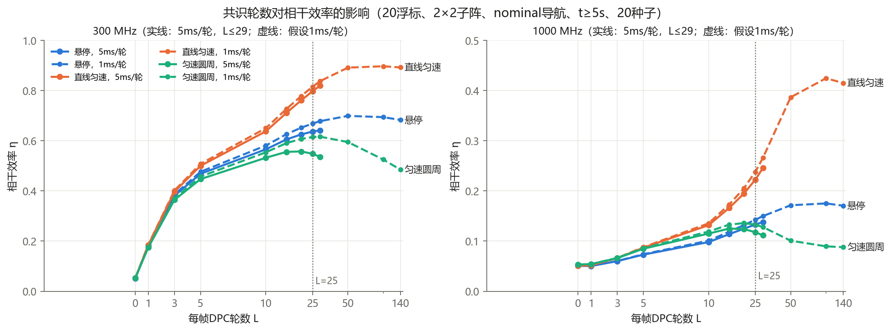
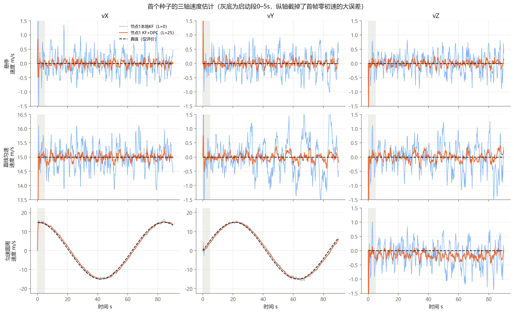
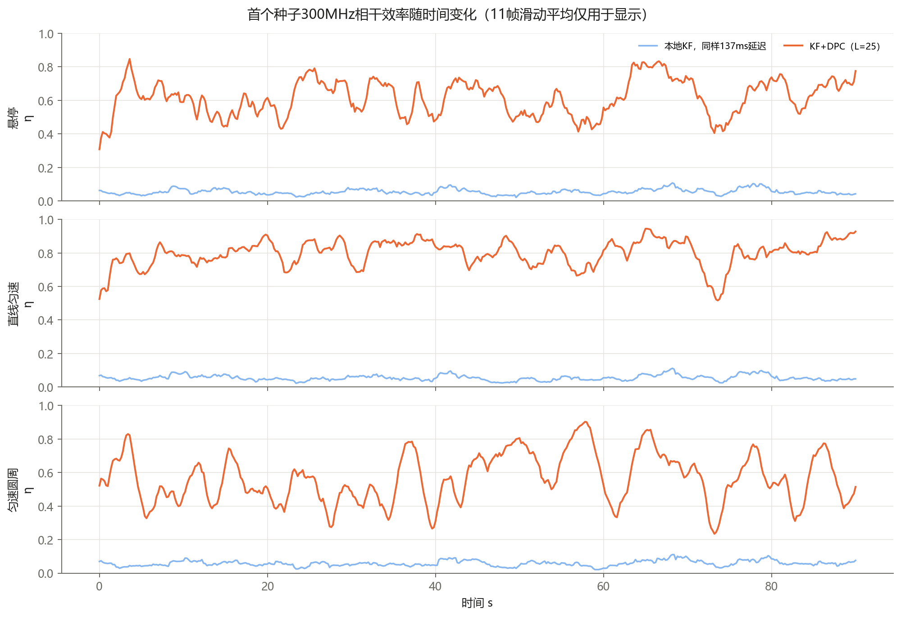
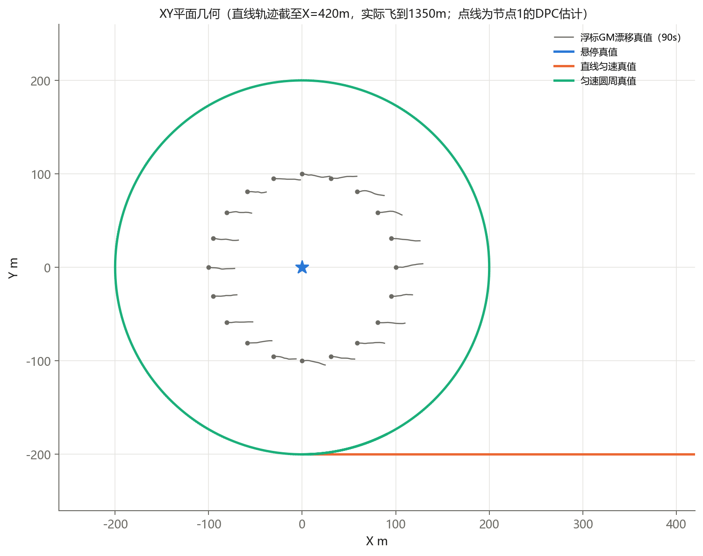

# GM修订版统一实验：一阶GM漂移 + 位置观测KF + DPC + 几何相位补偿

按 `docs/当前模型总结-KF后DPC-20261030_一阶GM修订版.md` 的设定实际运行。2026-10-30，20个种子 20261028–20261047，用时约157秒。

```powershell
python kf_dpc_coherent_5nodes/gm_dpc_unified/experiment.py --trials 20   # 仿真，写 outputs/*.csv、first_seed.npz
python kf_dpc_coherent_5nodes/gm_dpc_unified/report.py                   # 由已保存数据画图
```

## 实验设定

| 项目 | 设定 | 对应文档 |
|---|---|---|
| 浮标 | 20个，初始在半径100m圆上，高1.5m，逻辑环网，Metropolis权重1/3 | 8.2节、式(25) |
| 浮标运动 | 一阶GM：平均流[0.30,0]m/s，τ_v=20s，σ_v=0.05m/s，初始偏差0；垂向固定，姿态固定为单位阵，角速度0 | 式(3)–(6) |
| 导航 | nominal：位置0.02m、速度0.02m/s、横纵摇0.10°、艏向0.30°，各帧各节点独立白误差；ideal：误差为0 | 式(8)(9)(13) |
| 雷达 | 只测r/θ/φ，0.8m、0.35°、0.35° | 式(11)(12) |
| UAV滤波 | 六维CV线性KF，q=0.5m²/s³，首帧速度0、标准差20m/s，Joseph更新 | 式(14)–(22) |
| 融合 | KF后DPC，每帧从本地后验重新开始，不回灌KF；主结果L=25 | 式(24) |
| 延迟 | 12ms+5ms×L，L=25共137ms；时隙40ms，9个采样点 | 式(26) |
| 发射预测 | UAV：p̄+τ·v̄；浮标：GM条件均值；距离加距离变化率外推 | 式(27)–(33) |
| 发射 | 每浮标2×2子阵，阵元间距为300MHz半波长；总功率1W，均分给80个阵元；同步残差为0 | 式(34)–(38) |
| 轨迹 | 悬停[0,0,20]；直线[15t,−200,120]；圆周R=200m、15m/s、高120m；90s，Δt=0.2s | 式(39)–(41) |

GM真值在1ms细网格上生成。速度用精确离散，位置用梯形积分，统计规律与式(5)(6)相同。这样不同轮数对应的发射时刻真值都正好落在网格点上。三类轨迹、两种导航模式和所有轮数共用同一组浮标运动、导航误差和雷达噪声样本，可以直接配对比较。

除特别说明外，下表都统计t≥5s。RMSE按“全部种子×节点×帧”的平方误差取平均后再开方；功率指标先把功率累加，再求比值。

## 1. 主结果：nominal导航、L=25、5ms/轮

| 轨迹 | 方法 | 位置RMSE m | 速度RMSE m/s（X/Y/Z/3D） | 300MHz η | 300MHz 总增益 | 1000MHz η | 1000MHz 总增益 |
|---|---|---:|---:|---:|---:|---:|---:|
| 悬停 | 本地KF（L=0） | 0.680 | 0.355/0.353/0.337/**0.604** | 0.051 | 4.0倍（6.0 dB） | 0.050 | 4.0倍（6.0 dB） |
| 悬停 | KF+DPC（L=25） | 0.181 | 0.094/0.092/0.091/**0.160** | **0.636** | 50.3倍（17.0 dB） | **0.133** | 10.5倍（10.2 dB） |
| 直线匀速 | 本地KF（L=0） | 2.622 | 0.390/0.553/0.537/**0.864** | 0.052 | 4.0倍（6.1 dB） | 0.051 | 3.9倍（5.9 dB） |
| 直线匀速 | KF+DPC（L=25） | 0.695 | 0.103/0.146/0.144/**0.229** | **0.797** | 61.6倍（17.9 dB） | **0.222** | 17.2倍（12.3 dB） |
| 匀速圆周 | 本地KF（L=0） | 1.310 | 0.915/0.932/0.441/**1.379** | 0.054 | 4.0倍（6.0 dB） | 0.055 | 4.1倍（6.1 dB） |
| 匀速圆周 | KF+DPC（L=25） | 0.725 | 0.826/0.843/0.199/**1.197** | **0.548** | 41.1倍（16.1 dB） | **0.118** | 8.8倍（9.5 dB） |

本地KF也同样延迟137ms，保证比较公平。总增益是相对“80个阵元非相干功率和”的倍数，理想上界在固定总功率、等距离时为80倍。

| 300MHz，KF+DPC L=25 | 子阵增益 G_sub | 浮标间增益 G_inter | 实际几何的理想上界 | 差分路径误差RMSE：本地→DPC |
|---|---:|---:|---:|---:|
| 悬停 | 4.00 | 12.57 | 79.0 | 0.442 → 0.112 m |
| 直线匀速 | 4.00 | 15.40 | 77.2 | 0.443 → 0.075 m |
| 匀速圆周 | 4.00 | 10.26 | 74.9 | 0.448 → 0.130 m |

差分路径误差是指每个时刻每个阵元的距离命令误差，先去掉全网共同的部分（共同部分不影响相干），再取RMS。

**白话解读：**
- **只用本地KF时，20个浮标之间完全不相干。** η≈0.05=1/20，G_inter≈1，总增益≈4倍，只剩每个子阵内部4个阵元的增益。原因是各浮标对UAV的估计不一样，路径差约0.44m，在300MHz（波长1m）下相当于相位乱了约160°。
- **DPC后，300MHz能拿到16–18dB的总增益**，但η只有0.55–0.80，离理想上界还差约4–7dB。
- **1000MHz（波长0.3m）基本不行。** η只有0.12–0.22，同样0.1m左右的路径误差，在这个波长下已经是大约一半周期的相位误差。
- **子阵内部始终完全相干（G_sub=4.00）。** 同一浮标的4个阵元共用一个UAV估计，彼此间距只有0.5m，误差几乎一样，所以问题全出在浮标之间。

## 2. 共识轮数扫描



- **5ms/轮最多只能做29轮**（12+5L+40≤200ms），29轮离收敛还很远。L=25时节点间分歧仍在：悬停的位置分歧0.094m，直线0.36m，圆周0.17m。到L=100–140，分歧才降到1cm以下。
- **直线：轮数越多越好，到29轮仍在上升**（300MHz η：L=25为0.797，L=29为0.820）。如果网络能做到1ms/轮，L=50–100时η可到约0.89，1000MHz可到约0.42。
- **悬停：** 1ms/轮时L≈50达到饱和，η≈0.70。
- **圆周：L≈20–29最好，再多轮反而下降**（1ms/轮下L=140时η降到0.485）。圆周时CV模型有约0.8m/s的速度滞后，这部分滞后各节点都一样，共识消不掉。轮数越多，延迟τ_L越长，滞后乘以τ_L带来的预测误差就越大。

## 3. 消融对照（nominal，L=25，300MHz η）

| 轨迹 | 主方案（GM浮标预测） | 浮标常速度外推 | 浮标冻结不预测 | UAV不用速度 | 理想导航（主方案） |
|---|---:|---:|---:|---:|---:|
| 悬停 | 0.636 | 0.636 | 0.614 | **0.686** | 0.686 |
| 直线匀速 | 0.797 | 0.797 | 0.795 | 0.276 | 0.824 |
| 匀速圆周 | 0.548 | 0.548 | 0.540 | 0.056 | 0.591 |

- **GM预测与常速度外推完全一样。** 因为τ_L=0.137s远小于τ_v=20s，这正是文档6.2节说的“短时近似”。浮标完全不预测也只损失0.002–0.022。原因是平均流对所有浮标是同一个平移，大部分会在相位里抵消。
- **UAV速度预测**对直线和圆周不可缺：去掉后η从0.80降到0.28、从0.55降到0.06。对悬停却略有害：真实速度为0，估计出的速度噪声乘以137ms，反而引入误差。
- **nominal导航相比理想导航**，300MHz下η损失0.03–0.05。

## 4. 其他观察

- **圆周的速度误差主要是CV模型失配。** XY轴速度RMSE约0.83m/s，从L=25加到L=140几乎不变（1.197→1.192）。想要改善，需要换运动模型或调整q，共识轮数帮不上。
- **圆周的vZ估计有约−0.1～−0.2 m/s的偏差**（见速度图右下角）。一个可能的解释是：观测协方差R中XY与Z之间有耦合，XY方向持续的滞后经由卡尔曼增益传到了Z。这只是推测，没有单独验证。
- **启动段（0–5s）** 300MHz η：悬停0.53、直线0.65、圆周0.53。含首帧零初速时，全程速度RMSE为悬停0.205、直线0.799、圆周1.414m/s。







## 5. 与之前HCMCI实验的关系

`three_trajectories` 用的是HCMCI、六自由度波浪运动、3°同步残差，悬停点在[0,−200,120]，与本实验没有配对，数字不能直接相减。只能说：在文档规定的DPC设定下，N=20、L=25、5ms/轮时，节点间还没有充分一致，这是浮标间相干损失的主要来源之一。

## 6. 范围

各向同性阵元，不含互耦、多径、遮挡、丢包、接收噪声。导航误差为独立白误差，不含公共误差或时间相关误差。浮标姿态固定。直线轨迹最远飞到约1.36km，雷达噪声仍按固定值设置，没有随信噪比变差。20个种子只改变随机样本，每类轨迹都只有一条。
