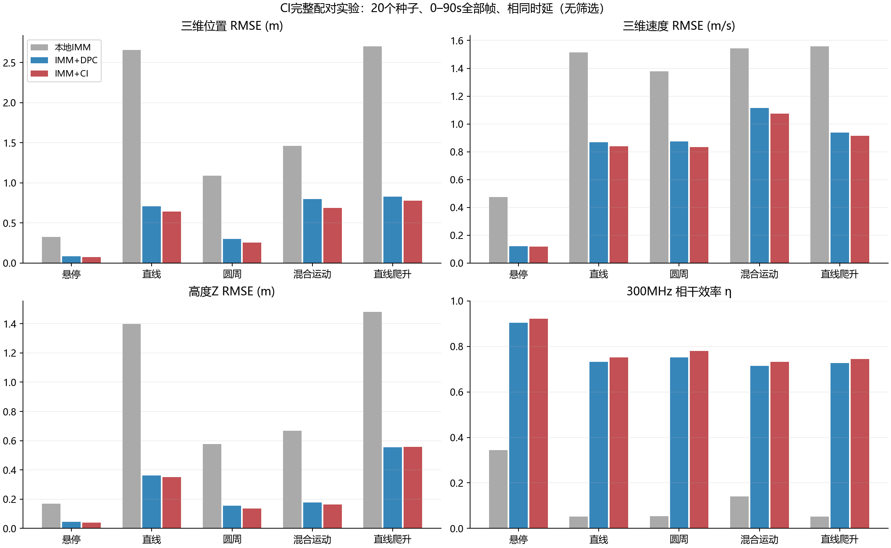
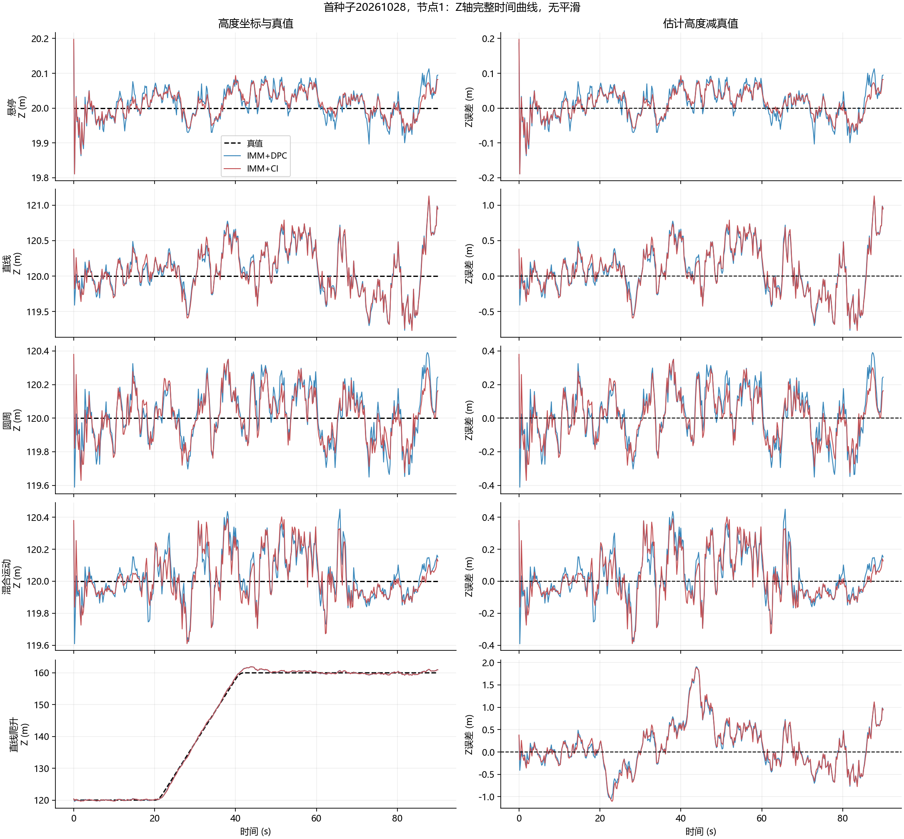
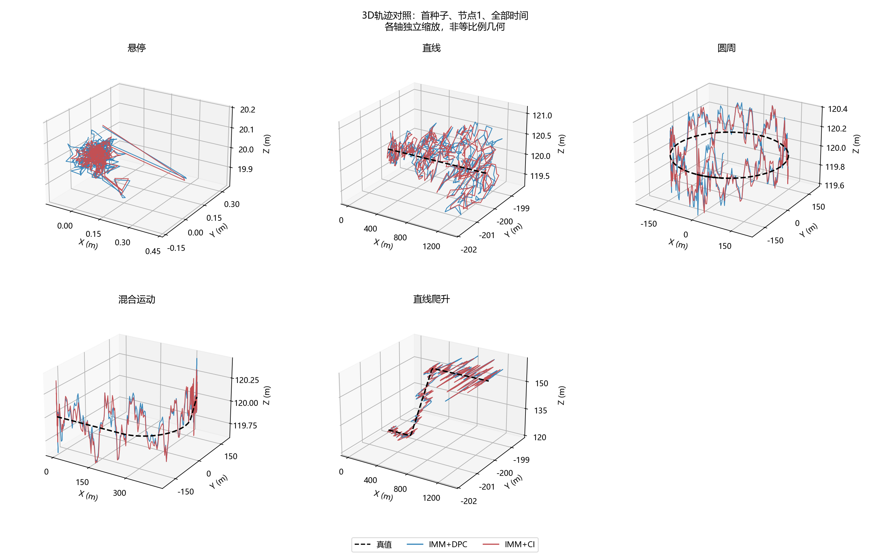

# IMM：DPC与CI融合完整实验

## Material Passport
- 阶段：已实现并运行的配对融合实验。
- 20个种子，范围[20261028, 20261047]；5条轨迹；全部节点、全部帧保留。
- 主表统计完整0–90s，不设置误差/功率达标门槛，不剔除起动、机动或异常样本。分段表仅用于解释。
- 同一份IMM后验，位置/速度及模型参数不变；只有融合规则不同。

## 定义与公平性
- CI=Covariance Intersection：固定Metropolis权重的信息域凸共识，不是独立信息求和。
- 每轮Y_i=sum_j w_ij P_j^-1，y_i=sum_j w_ij P_j^-1 x_j；输出P_i=Y_i^-1，x_i=P_i y_i。
- 20节点环网、25轮、137ms起始延迟、40ms时隙。local也按同样发射时刻评价。
- W^25是有限轮邻居交换的等效计算，不代替为全网集中均值。不回灌IMM。
- 各分支预测均值及协方差，再保留模型间散布做矩匹配；先对omega边际化，再形成六维信息。
- 未做CI权重logdet/trace优化。所有协方差及节点权重来自观测与滤波，不使用真值。

## 全时段相干效率

|轨迹|DPC 300MHz|CI 300MHz|CI−DPC及95%配对区间|DPC 1GHz|CI 1GHz|
|---|---:|---:|---:|---:|---:|
|悬停|0.904|0.921|+0.017 ± 0.001|0.426|0.491|
|直线|0.732|0.752|+0.020 ± 0.006|0.202|0.219|
|圆周|0.753|0.780|+0.027 ± 0.004|0.201|0.223|
|混合运动|0.715|0.732|+0.017 ± 0.004|0.299|0.332|
|直线爬升|0.726|0.745|+0.019 ± 0.006|0.198|0.213|

区间反映固定轨迹下随机种子变化，未作多重比较校正，不是任意飞行任务的保证。

## 全时段跟踪与差分路径误差

|轨迹|方法|三维位置m|三维速度m/s|高度Z m|垂直速度m/s|差分路径m|
|---|---|---:|---:|---:|---:|---:|
|悬停|local|0.325|0.476|0.169|0.242|0.210|
|悬停|dpc|0.085|0.123|0.045|0.068|0.055|
|悬停|ci|0.077|0.118|0.040|0.066|0.050|
|直线|local|2.655|1.516|1.398|0.564|0.447|
|直线|dpc|0.706|0.868|0.362|0.151|0.090|
|直线|ci|0.643|0.839|0.352|0.138|0.087|
|圆周|local|1.088|1.377|0.576|0.500|0.470|
|圆周|dpc|0.301|0.876|0.154|0.134|0.099|
|圆周|ci|0.255|0.834|0.137|0.122|0.093|
|混合运动|local|1.462|1.543|0.669|0.500|0.421|
|混合运动|dpc|0.798|1.116|0.177|0.136|0.208|
|混合运动|ci|0.686|1.073|0.164|0.123|0.189|
|直线爬升|local|2.700|1.557|1.481|0.677|0.450|
|直线爬升|dpc|0.827|0.939|0.556|0.384|0.091|
|直线爬升|ci|0.779|0.916|0.556|0.387|0.088|

## 混合运动分段（所有该阶段帧，不按效果筛选）

|阶段|DPC位置m|CI位置m|DPC 300MHz η|CI 300MHz η|
|---|---:|---:|---:|---:|
|acceleration|2.484|2.115|0.150|0.134|
|turn_entry|0.933|0.745|0.506|0.597|
|turn_steady|0.430|0.357|0.772|0.793|
|braking|0.876|1.064|0.495|0.342|
|hover_end|0.183|0.150|0.942|0.952|

## 混合运动协方差诊断：六维NEES的均值

|阶段|DPC|CI|
|---|---:|---:|
|all|2.775|3.371|
|acceleration|38.300|48.954|
|turn_steady|0.263|0.230|
|braking|0.990|1.907|

NEES来自误差与输出协方差的比较，只用于解释，不决定保留哪些数据。机动段数值很大时，说明误差相对于估计不确定度偏大；CI不能保证修复这种输入模型失配。全程平均改善可能伴随机动局部退化，应同时读取上表。

## 去掉启动5s的辅助对照（不是主结果）

|轨迹|DPC位置m|CI位置m|DPC Z m|CI Z m|DPC 300MHz η|CI 300MHz η|
|---|---:|---:|---:|---:|---:|---:|
|悬停|0.076|0.066|0.041|0.035|0.919|0.936|
|直线|0.717|0.654|0.368|0.359|0.795|0.803|
|圆周|0.282|0.238|0.150|0.133|0.770|0.795|
|混合运动|0.817|0.702|0.176|0.164|0.710|0.726|
|直线爬升|0.842|0.795|0.570|0.571|0.788|0.795|

## 边界与可解释性
- 本次混合运动的起飞加速和刹停阶段，CI相干效率低于DPC；刹停阶段位置误差也更大。全程平均改善不能掩盖这些局部退化。
- 起飞加速阶段CI三维位置RMSE虽下降，相干效率却下降，说明绝对位置精度与跨节点差分路径精度并不等价。
- CI的保守性以输入协方差可信为前提；IMM/EKF与坐标转换是近似，不宣称严格一致性。NEES仅保存为诊断量，无门控。
- 同一后验的不确定度存在方向差异时，信息融合可以优于坐标等权平均；输入协方差相同时，CI均值退化为DPC均值。
- CI不能凭空补充未观测的速度，也不自动消除所有节点共有的机动滞后、偏置或错误运动模型。
- 固定相同时延隔离算法影响。CI需要交换协方差，消息量及硬件处理开销未实测；实际带宽受限时可能改变结果。
- 参数未重新调优；模型窗内冻结、固定姿态、独立白导航误差、理想载波同步及自由空间假设与旧实验一致。
- 只增加旧IMM的可选分支协方差返回值，没有改变滤波递推。首种子DPC状态与两频率功率曲线已与旧数据核对。

## 来源
- Julier & Uhlmann (1997): https://doi.org/10.1109/ACC.1997.609105 （CI原始出处）
- MathWorks CI: https://www.mathworks.com/help/fusion/ref/fusecovint.html （官方实现为优化权重，区别于本固定权重实验）

详细正式文献、CI一致性证明及状态误差到相干功率的推导见 [THEORY.md](THEORY.md)。
