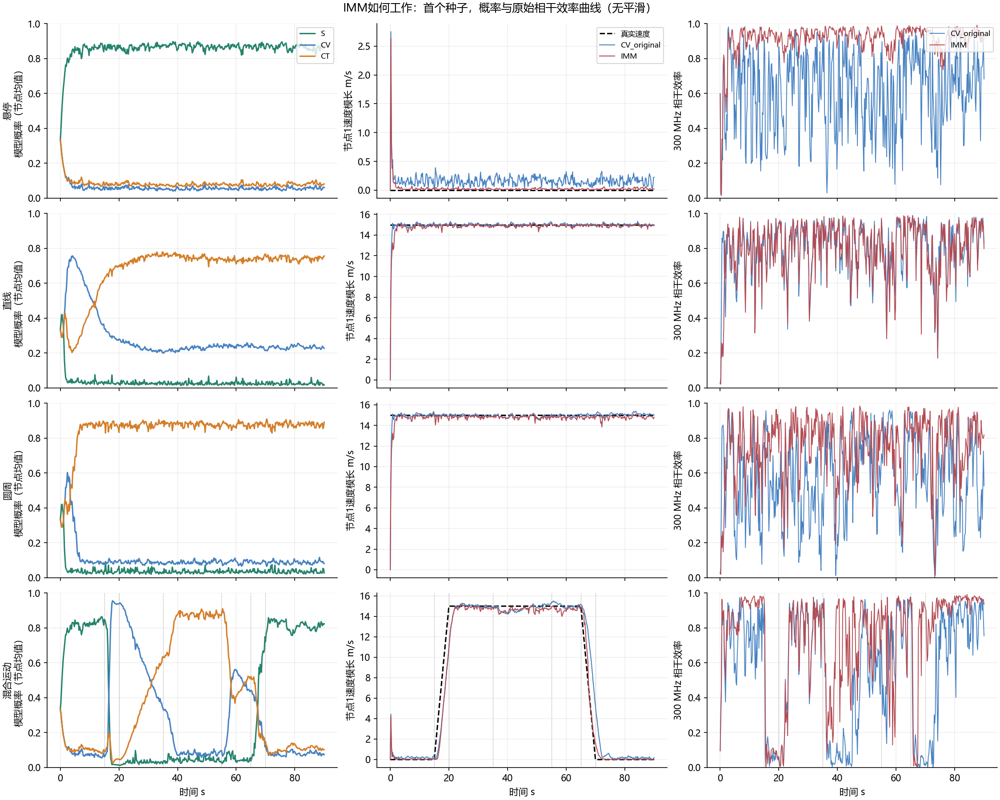
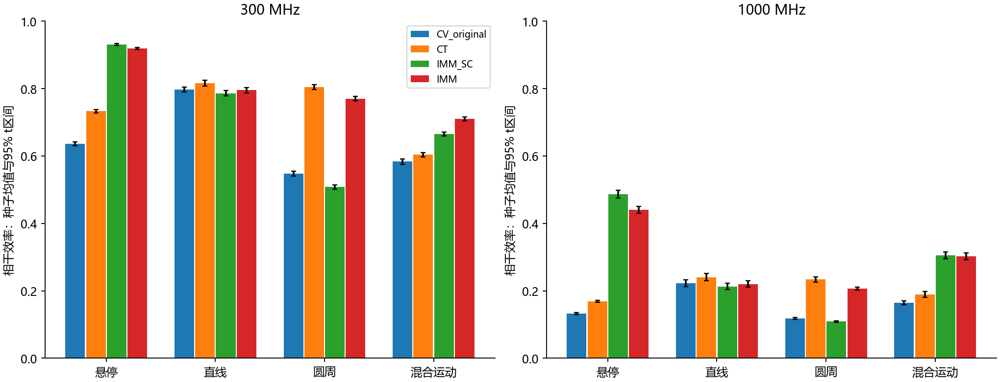

# IMM首版实验报告

## Material Passport
- 阶段：首版探索性实现与配对实验。
- 输入：固定的GM浮标、nominal导航、位置观测；无多普勒、真值标签或未来测量。
- 输出：20个配对种子，原始CSV、首种子NPZ和图。
- 判定：已运行；参数未经独立校准，不能声称泛化或全局最优。

## 相干效率（t≥5s，先按每种子求η，再平均）

|轨迹|CV 300MHz|IMM 300MHz|配对提升及95%区间|CV 1GHz|IMM 1GHz|
|---|---:|---:|---:|---:|---:|
|悬停|0.636|0.919|+0.282 ± 0.006|0.133|0.440|
|直线|0.797|0.795|-0.002 ± 0.003|0.222|0.220|
|圆周|0.548|0.770|+0.222 ± 0.007|0.118|0.207|
|混合运动|0.583|0.710|+0.127 ± 0.005|0.164|0.302|

区间只反映固定轨迹与噪声模型下的种子变化；未作多重比较校正，不代表所有飞行任务的置信范围。

## 位置、速度和差分路径误差（300MHz对应行，跨种子合并平方误差）

|轨迹|方法|位置RMSE m|速度RMSE m/s|未来位置RMSE m|差分路径RMSE m|
|---|---|---:|---:|---:|---:|
|悬停|CV_original|0.181|0.160|0.201|0.112|
|悬停|CT|0.151|0.088|0.162|0.091|
|悬停|IMM_SC|0.069|0.018|0.071|0.043|
|悬停|IMM|0.076|0.023|0.078|0.047|
|直线|CV_original|0.695|0.229|0.723|0.075|
|直线|CT|0.712|0.266|0.745|0.071|
|直线|IMM_SC|0.695|0.274|0.724|0.077|
|直线|IMM|0.717|0.297|0.750|0.075|
|圆周|CV_original|0.725|1.197|0.915|0.130|
|圆周|CT|0.259|0.145|0.277|0.077|
|圆周|IMM_SC|0.738|1.219|0.934|0.139|
|圆周|IMM|0.282|0.294|0.314|0.085|
|混合运动|CV_original|1.427|1.775|1.696|0.261|
|混合运动|CT|2.593|2.240|2.921|0.456|
|混合运动|IMM_SC|1.065|1.397|1.280|0.227|
|混合运动|IMM|0.817|1.129|0.988|0.213|

## 模型权重（各节点、帧与种子平均）

|轨迹|近悬停S|CV|CT|
|---|---:|---:|---:|
|悬停|0.863|0.056|0.080|
|直线|0.026|0.274|0.700|
|圆周|0.034|0.090|0.875|
|混合运动|0.349|0.272|0.379|

## 混合轨迹分段：300MHz η

|阶段|CV|IMM|
|---|---:|---:|
|hover_start|0.784|0.943|
|acceleration|0.140|0.150|
|straight_segment|0.805|0.801|
|turn_entry|0.315|0.506|
|turn_steady|0.457|0.772|
|braking|0.176|0.495|
|hover_end|0.798|0.942|

## 如何读结果与限制

- S把近零速度作为软先验；CV覆盖直线；CT从位置历史估计未知转弯率。所有分支共用七维状态，协方差混合含模型间分歧。
- 每帧按预测创新及其协方差更新概率。CT的零转弯率极限也能描述直线，因此概率不是分类准确率。
- CT过程噪声强度比CV更小，所以单CT/IMM的改善同时可能包含模型和噪声参数收益，不能全部归于“识别了转弯”。需后续同q消融与独立校准。
- IMM_SC对照揭示仅加入悬停分支是否足够；CT单模型揭示纯圆周可能更适合单模型，IMM不是每种情况下都最好。
- CV_exact只改变逐时隙几何计算；与CV_original的差异隔离预测接口收益。完整IMM先逐分支预测、概率加权，再做25轮DPC；不回灌本地滤波。
- 预测窗≤177ms内冻结模式，是近似；模式切换仍有检测延迟，不能预知起飞、刹停或转弯。混合轨迹速度连续，切向加速度有阶段变化。
- 相同12ms处理与5ms/轮属于链路假设。9时隙预测提高消息负载，额外运算、真实硬件时延与带宽尚未闭环验证。filter_seconds仅为本机20节点批处理的滤波耗时。
- 载波频相已同步、导航独立白误差、固定姿态、自由空间；不涵盖多径及复杂三维机动。
- 参数固定后直接做首版探索：没有独立校准集和未见轨迹测试，不据此宣称最终性能。原始CV文件与结果未覆盖。

## 理论来源
- Blom & Bar-Shalom (1988), https://doi.org/10.1109/9.1299 （IMM原始出处；本次未取得IEEE正文）
- Yuan et al. (2014), https://doi.org/10.1155/2014/649276 （未知转弯率CT模型；不是复现其EM算法）
- Huang et al. (2017), https://isif.org/files/isif/2024-01/JAIF_Vol12_1_complete_170828_7.pdf （IMM机动跟踪应用，传感器不同）

