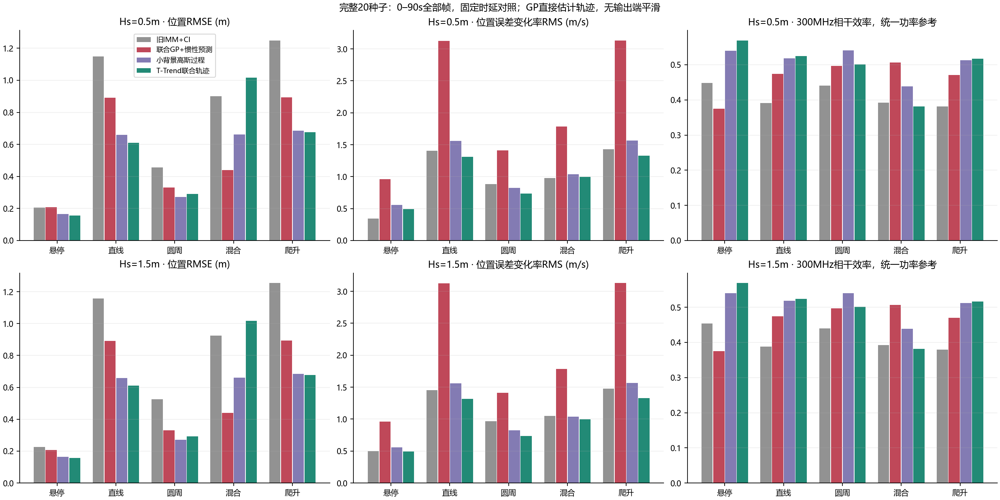
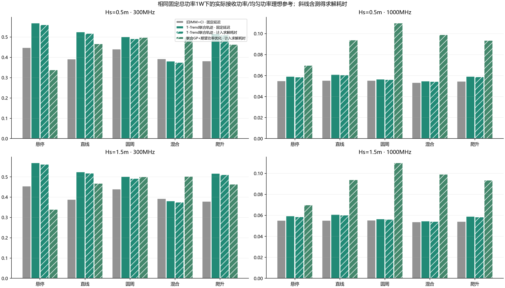
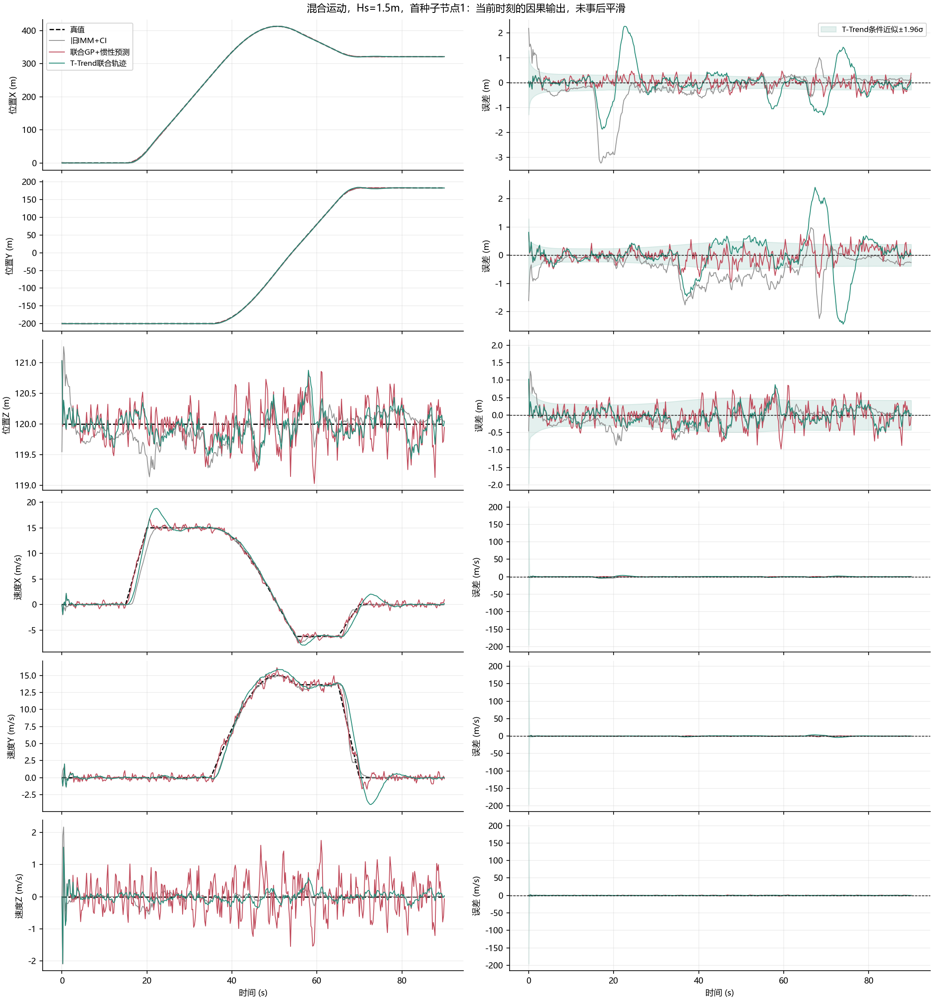
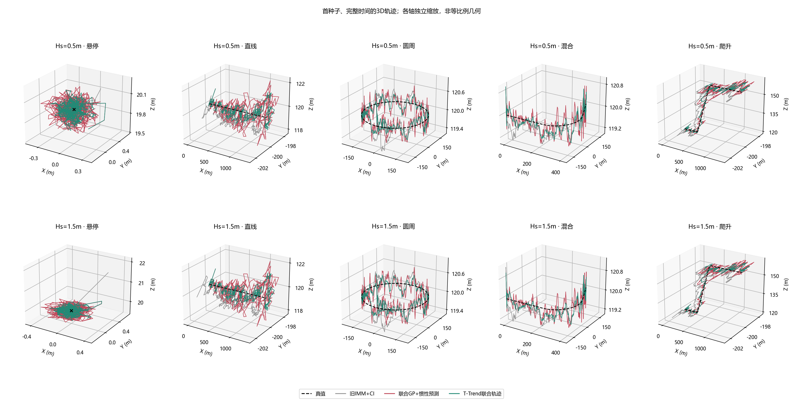
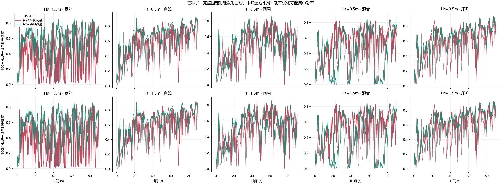

# 文献驱动的联合GP轨迹估计：完整实验结果

## Material Passport
- 两项完整20种子研究：两海况、五轨迹、合计七方法、两载频、两种时延评价，正式44800行种子级分段指标。
- 全时段0–90s为主结果；无输出后处理平滑、门控或样本剔除。
- 同样原始伪距/IMU/磁场/雷达、同样物理真值与随机数；杆臂为零、20单阵元浮标、固定总功率1W。
- 新方法为集中增广迭代MAP、持久到达因子与目标随机克隆，不是已经完成的有限轮分布式GP。
- 完整公式、正式文献、计数和适用边界见RESEARCH.md及T_TREND.md。

## 全时段固定时延对照

|Hs m|轨迹|方法|位置RMSE m|速度RMSE m/s|位置误差变化率 m/s|未来位置RMSE m|η300MHz|η1GHz|位置95%名义区域覆盖率|
|---|---|---|---:|---:|---:|---:|---:|---:|---:|
|0.5|悬停|旧IMM+CI|0.2055|0.1593|0.3465|0.2118|0.4478|0.0550|1.000|
|0.5|悬停|GP+独立导航近似|0.2621|0.5676|1.0126|0.3278|0.2867|0.0517|0.928|
|0.5|悬停|联合GP+直线浮标预测|0.2073|0.5138|0.9594|0.2765|0.3745|0.0546|0.970|
|0.5|悬停|联合GP+惯性预测|0.2073|0.5138|0.9594|0.2765|0.3745|0.0546|0.970|
|0.5|悬停|联合GP+期望功率优化|0.2073|0.5138|0.9594|0.2765|0.3837|0.0704|0.970|
|0.5|悬停|小背景高斯过程|0.1650|0.2433|0.5588|0.1910|0.5396|0.0577|0.970|
|0.5|悬停|T-Trend联合轨迹|0.1562|0.2229|0.4949|0.1782|0.5691|0.0591|0.965|
|0.5|直线|旧IMM+CI|1.1483|1.0219|1.4041|1.2064|0.3911|0.0554|1.000|
|0.5|直线|GP+独立导航近似|1.0596|1.3685|3.1667|1.1986|0.3773|0.0584|0.947|
|0.5|直线|联合GP+直线浮标预测|0.8918|1.3253|3.1255|1.0434|0.4748|0.0584|0.965|
|0.5|直线|联合GP+惯性预测|0.8918|1.3253|3.1255|1.0434|0.4744|0.0585|0.965|
|0.5|直线|联合GP+期望功率优化|0.8918|1.3253|3.1255|1.0434|0.4888|0.0945|0.965|
|0.5|直线|小背景高斯过程|0.6594|0.8334|1.5578|0.7161|0.5186|0.0610|0.968|
|0.5|直线|T-Trend联合轨迹|0.6106|0.8036|1.3129|0.6580|0.5245|0.0611|0.968|
|0.5|圆周|旧IMM+CI|0.4561|1.0542|0.8844|0.5491|0.4404|0.0554|1.000|
|0.5|圆周|GP+独立导航近似|0.3879|1.0524|1.4861|0.4927|0.4154|0.0553|0.953|
|0.5|圆周|联合GP+直线浮标预测|0.3297|0.9852|1.4098|0.4358|0.4972|0.0557|0.965|
|0.5|圆周|联合GP+惯性预测|0.3297|0.9852|1.4098|0.4358|0.4971|0.0557|0.965|
|0.5|圆周|联合GP+期望功率优化|0.3297|0.9852|1.4098|0.4358|0.5258|0.1101|0.965|
|0.5|圆周|小背景高斯过程|0.2717|0.8081|0.8217|0.3362|0.5407|0.0581|0.952|
|0.5|圆周|T-Trend联合轨迹|0.2911|0.8248|0.7336|0.3619|0.5010|0.0565|0.881|
|0.5|混合|旧IMM+CI|0.9010|1.1458|0.9804|1.0561|0.3925|0.0534|0.949|
|0.5|混合|GP+独立导航近似|0.5366|0.9323|1.8533|0.6441|0.4028|0.0548|0.944|
|0.5|混合|联合GP+直线浮标预测|0.4394|0.8395|1.7856|0.5498|0.5065|0.0559|0.965|
|0.5|混合|联合GP+惯性预测|0.4394|0.8395|1.7856|0.5498|0.5063|0.0559|0.965|
|0.5|混合|联合GP+期望功率优化|0.4394|0.8395|1.7856|0.5498|0.5283|0.0990|0.965|
|0.5|混合|小背景高斯过程|0.6610|1.1324|1.0364|0.8248|0.4388|0.0556|0.720|
|0.5|混合|T-Trend联合轨迹|1.0174|1.5082|0.9944|1.2395|0.3812|0.0547|0.557|
|0.5|爬升|旧IMM+CI|1.2486|1.0866|1.4272|1.3212|0.3819|0.0546|1.000|
|0.5|爬升|GP+独立导航近似|1.0662|1.3752|3.1763|1.2056|0.3730|0.0577|0.947|
|0.5|爬升|联合GP+直线浮标预测|0.8946|1.3319|3.1327|1.0469|0.4709|0.0575|0.965|
|0.5|爬升|联合GP+惯性预测|0.8946|1.3319|3.1327|1.0469|0.4706|0.0575|0.965|
|0.5|爬升|联合GP+期望功率优化|0.8946|1.3319|3.1327|1.0469|0.4847|0.0939|0.965|
|0.5|爬升|小背景高斯过程|0.6854|0.8847|1.5659|0.7512|0.5126|0.0595|0.945|
|0.5|爬升|T-Trend联合轨迹|0.6769|0.8784|1.3255|0.7404|0.5167|0.0593|0.901|
|1.5|悬停|旧IMM+CI|0.2257|0.2013|0.4969|0.2322|0.4542|0.0551|1.000|
|1.5|悬停|GP+独立导航近似|0.2605|0.5686|1.0115|0.3264|0.2893|0.0517|0.930|
|1.5|悬停|联合GP+直线浮标预测|0.2074|0.5136|0.9595|0.2765|0.3746|0.0547|0.970|
|1.5|悬停|联合GP+惯性预测|0.2074|0.5136|0.9595|0.2765|0.3747|0.0547|0.970|
|1.5|悬停|联合GP+期望功率优化|0.2074|0.5136|0.9595|0.2765|0.3840|0.0704|0.970|
|1.5|悬停|小背景高斯过程|0.1651|0.2433|0.5593|0.1911|0.5398|0.0579|0.970|
|1.5|悬停|T-Trend联合轨迹|0.1563|0.2229|0.4955|0.1783|0.5693|0.0593|0.966|
|1.5|直线|旧IMM+CI|1.1578|1.0709|1.4547|1.2175|0.3884|0.0551|0.998|
|1.5|直线|GP+独立导航近似|1.0477|1.3685|3.1614|1.1875|0.3777|0.0580|0.949|
|1.5|直线|联合GP+直线浮标预测|0.8912|1.3250|3.1241|1.0428|0.4746|0.0583|0.965|
|1.5|直线|联合GP+惯性预测|0.8912|1.3250|3.1241|1.0428|0.4744|0.0585|0.965|
|1.5|直线|联合GP+期望功率优化|0.8912|1.3250|3.1241|1.0428|0.4889|0.0945|0.965|
|1.5|直线|小背景高斯过程|0.6590|0.8336|1.5582|0.7158|0.5185|0.0607|0.968|
|1.5|直线|T-Trend联合轨迹|0.6101|0.8037|1.3137|0.6575|0.5244|0.0608|0.968|
|1.5|圆周|旧IMM+CI|0.5256|1.1065|0.9651|0.6199|0.4396|0.0554|0.997|
|1.5|圆周|GP+独立导航近似|0.3862|1.0531|1.4839|0.4912|0.4160|0.0548|0.954|
|1.5|圆周|联合GP+直线浮标预测|0.3296|0.9851|1.4095|0.4357|0.4971|0.0558|0.965|
|1.5|圆周|联合GP+惯性预测|0.3296|0.9851|1.4095|0.4357|0.4973|0.0559|0.965|
|1.5|圆周|联合GP+期望功率优化|0.3296|0.9851|1.4095|0.4357|0.5261|0.1102|0.965|
|1.5|圆周|小背景高斯过程|0.2722|0.8083|0.8235|0.3367|0.5406|0.0580|0.951|
|1.5|圆周|T-Trend联合轨迹|0.2916|0.8249|0.7357|0.3624|0.5009|0.0565|0.879|
|1.5|混合|旧IMM+CI|0.9244|1.1541|1.0472|1.0749|0.3923|0.0537|0.947|
|1.5|混合|GP+独立导航近似|0.5331|0.9322|1.8503|0.6407|0.4040|0.0547|0.947|
|1.5|混合|联合GP+直线浮标预测|0.4389|0.8388|1.7850|0.5492|0.5066|0.0558|0.965|
|1.5|混合|联合GP+惯性预测|0.4389|0.8388|1.7850|0.5492|0.5067|0.0560|0.965|
|1.5|混合|联合GP+期望功率优化|0.4389|0.8388|1.7850|0.5492|0.5288|0.0991|0.965|
|1.5|混合|小背景高斯过程|0.6602|1.1315|1.0374|0.8238|0.4390|0.0554|0.721|
|1.5|混合|T-Trend联合轨迹|1.0164|1.5072|0.9955|1.2383|0.3814|0.0545|0.557|
|1.5|爬升|旧IMM+CI|1.2550|1.1328|1.4770|1.3288|0.3792|0.0542|0.998|
|1.5|爬升|GP+独立导航近似|1.0541|1.3751|3.1709|1.1943|0.3734|0.0573|0.949|
|1.5|爬升|联合GP+直线浮标预测|0.8940|1.3316|3.1312|1.0463|0.4707|0.0574|0.965|
|1.5|爬升|联合GP+惯性预测|0.8940|1.3316|3.1312|1.0463|0.4706|0.0575|0.965|
|1.5|爬升|联合GP+期望功率优化|0.8940|1.3316|3.1312|1.0463|0.4848|0.0939|0.965|
|1.5|爬升|小背景高斯过程|0.6852|0.8850|1.5664|0.7511|0.5125|0.0592|0.945|
|1.5|爬升|T-Trend联合轨迹|0.6767|0.8786|1.3263|0.7403|0.5166|0.0589|0.900|

## 求解耗时与计入耗时后的相干结果

|Hs m|轨迹|方法|计算均值ms|计算P95 ms|时隙末端平均ms|η300MHz|G300MHz dB|η1GHz|G1GHz dB|有效节点数300MHz|
|---|---|---|---:|---:|---:|---:|---:|---:|---:|---:|
|0.5|悬停|旧IMM+CI|14.13|14.13|179.13|0.4476|9.126|0.0550|0.323|20.00|
|0.5|悬停|联合GP+惯性预测|71.53|80.07|236.53|0.3288|8.116|0.0542|0.284|20.00|
|0.5|悬停|T-Trend联合轨迹|39.15|45.04|204.15|0.5609|10.439|0.0585|0.614|20.00|
|0.5|悬停|联合GP+期望功率优化|71.53|80.07|236.53|0.3380|7.691|0.0698|0.074|15.52|
|0.5|直线|旧IMM+CI|14.02|14.02|179.02|0.3906|8.733|0.0554|0.256|20.00|
|0.5|直线|联合GP+惯性预测|71.71|81.52|236.71|0.4526|9.380|0.0574|0.408|20.00|
|0.5|直线|T-Trend联合轨迹|38.89|44.37|203.89|0.5182|9.969|0.0606|0.634|20.00|
|0.5|直线|联合GP+期望功率优化|71.71|81.52|236.71|0.4670|8.566|0.0939|0.149|17.91|
|0.5|圆周|旧IMM+CI|14.00|14.00|179.00|0.4400|9.153|0.0554|0.158|20.00|
|0.5|圆周|联合GP+惯性预测|71.25|79.69|236.25|0.4703|9.449|0.0551|0.127|20.00|
|0.5|圆周|T-Trend联合轨迹|38.90|44.16|203.90|0.4911|9.629|0.0562|0.211|20.00|
|0.5|圆周|联合GP+期望功率优化|71.25|79.69|236.25|0.4983|8.501|0.1101|0.013|14.65|
|0.5|混合|旧IMM+CI|13.73|13.73|178.73|0.3922|8.716|0.0534|0.053|20.00|
|0.5|混合|联合GP+惯性预测|70.17|77.81|235.17|0.4799|9.601|0.0551|0.200|20.00|
|0.5|混合|T-Trend联合轨迹|38.73|44.13|203.73|0.3747|8.526|0.0544|0.135|20.00|
|0.5|混合|联合GP+期望功率优化|70.17|77.81|235.17|0.5016|8.824|0.0990|0.010|16.10|
|0.5|爬升|旧IMM+CI|13.99|13.99|178.99|0.3814|8.628|0.0546|0.193|20.00|
|0.5|爬升|联合GP+惯性预测|70.45|77.41|235.45|0.4493|9.348|0.0565|0.346|20.00|
|0.5|爬升|T-Trend联合轨迹|38.37|43.90|203.37|0.5103|9.902|0.0589|0.514|20.00|
|0.5|爬升|联合GP+期望功率优化|70.45|77.41|235.45|0.4636|8.534|0.0935|0.121|17.95|
|1.5|悬停|旧IMM+CI|13.28|13.28|178.28|0.4541|9.225|0.0551|0.331|20.00|
|1.5|悬停|联合GP+惯性预测|69.29|76.51|234.29|0.3306|8.140|0.0544|0.299|20.00|
|1.5|悬停|T-Trend联合轨迹|38.41|44.18|203.41|0.5613|10.442|0.0587|0.626|20.00|
|1.5|悬停|联合GP+期望功率优化|69.29|76.51|234.29|0.3398|7.718|0.0698|0.074|15.57|
|1.5|直线|旧IMM+CI|13.24|13.24|178.24|0.3881|8.705|0.0551|0.231|20.00|
|1.5|直线|联合GP+惯性预测|70.25|79.95|235.25|0.4535|9.388|0.0571|0.388|20.00|
|1.5|直线|T-Trend联合轨迹|38.31|44.09|203.31|0.5183|9.970|0.0601|0.602|20.00|
|1.5|直线|联合GP+期望功率优化|70.25|79.95|235.25|0.4680|8.577|0.0939|0.149|17.91|
|1.5|圆周|旧IMM+CI|13.24|13.24|178.24|0.4393|9.146|0.0553|0.152|20.00|
|1.5|圆周|联合GP+惯性预测|68.28|75.63|233.28|0.4719|9.464|0.0552|0.134|20.00|
|1.5|圆周|T-Trend联合轨迹|38.25|43.77|203.25|0.4913|9.630|0.0562|0.204|20.00|
|1.5|圆周|联合GP+期望功率优化|68.28|75.63|233.28|0.5000|8.518|0.1101|0.013|14.67|
|1.5|混合|旧IMM+CI|13.25|13.25|178.25|0.3921|8.716|0.0537|0.075|20.00|
|1.5|混合|联合GP+惯性预测|69.13|79.39|234.13|0.4807|9.608|0.0551|0.195|20.00|
|1.5|混合|T-Trend联合轨迹|38.84|45.31|203.84|0.3748|8.527|0.0542|0.120|20.00|
|1.5|混合|联合GP+期望功率优化|69.13|79.39|234.13|0.5025|8.832|0.0990|0.012|16.11|
|1.5|爬升|旧IMM+CI|13.21|13.21|178.23|0.3789|8.599|0.0542|0.163|20.00|
|1.5|爬升|联合GP+惯性预测|70.62|79.34|235.62|0.4497|9.351|0.0562|0.319|20.00|
|1.5|爬升|T-Trend联合轨迹|38.69|45.12|203.69|0.5102|9.901|0.0583|0.475|20.00|
|1.5|爬升|联合GP+期望功率优化|70.62|79.34|235.62|0.4641|8.539|0.0935|0.121|17.95|

计算时间为当前电脑并行负载下的求解加导航平均耗时，未计全预测、功率优化、通信编解码和真实带宽开销；不是实时硬件保证。若时隙末端超过200ms，则不满足原先帧内结束整个时隙的约束，未剔除这些样本。

## 混合机动的局部置信度

|Hs m|阶段|方法|位置RMSE m|位置95%名义区域覆盖率|六维NEES|
|---|---|---|---:|---:|---:|
|0.5|all|旧IMM+CI|0.9010|0.949|3.826|
|0.5|all|联合GP+惯性预测|0.4394|0.965|4.534|
|0.5|all|T-Trend联合轨迹|1.0174|0.557|153.773|
|0.5|acceleration|旧IMM+CI|2.4131|0.222|49.084|
|0.5|acceleration|联合GP+惯性预测|0.3196|0.956|4.921|
|0.5|acceleration|T-Trend联合轨迹|1.3500|0.154|503.278|
|0.5|turn_steady|旧IMM+CI|0.6482|1.000|0.574|
|0.5|turn_steady|联合GP+惯性预测|0.5117|0.965|4.362|
|0.5|turn_steady|T-Trend联合轨迹|0.6892|0.484|33.626|
|0.5|braking|旧IMM+CI|1.2039|1.000|1.877|
|0.5|braking|联合GP+惯性预测|0.4847|0.942|5.165|
|0.5|braking|T-Trend联合轨迹|2.1231|0.150|505.672|
|1.5|all|旧IMM+CI|0.9244|0.947|3.948|
|1.5|all|联合GP+惯性预测|0.4389|0.965|4.529|
|1.5|all|T-Trend联合轨迹|1.0164|0.557|153.733|
|1.5|acceleration|旧IMM+CI|2.4063|0.222|49.009|
|1.5|acceleration|联合GP+惯性预测|0.3188|0.958|4.914|
|1.5|acceleration|T-Trend联合轨迹|1.3462|0.154|503.042|
|1.5|turn_steady|旧IMM+CI|0.6402|1.000|0.564|
|1.5|turn_steady|联合GP+惯性预测|0.5112|0.967|4.359|
|1.5|turn_steady|T-Trend联合轨迹|0.6884|0.485|33.631|
|1.5|braking|旧IMM+CI|1.1998|1.000|1.874|
|1.5|braking|联合GP+惯性预测|0.4846|0.946|5.163|
|1.5|braking|T-Trend联合轨迹|2.1209|0.152|505.548|

## 解释和复现边界
- 基线首种子两海况五轨迹与原完整数据的最大状态差：0。
- RMSE等列为先按种子计算、再跨种子平均；配对CSV给20种子差值的Student-t 95%区间，未作多重比较校正。时序/节点不作为独立显著性样本。
- 位置误差变化率针对估计减真值的变化，不是单纯奖励小jerk；完整启动和机动均保留。
- η主列统一使用均匀功率理想参考；功率重分配可能使该η超过1。另存eta_optimal_bound为任意分配最优理想上界归一化，eta_own只作自身分配同相效率。
- 主特征向量仅在条件高斯/预测幅度/固定总功率下最大化预测期望接收功率；不保证实际全局最优、不保证所有浮标保持高相干，必须同时看G及有效节点数。
- 波浪分解不再由真实分量提供，也没有再次对导航后验进行独立噪声假设的波浪滤波；惯性预测只使用当前传感器和联合导航修正。
- 一阶导航误差坐标、三次Gauss–Newton及持久Gaussian到达因子均为近似，经验置信度以数据为准。旧目标克隆按协方差主子块边际化，旧信息持续保留；每次只加入当前原始观测一次，不重复使用窗口观测。
- 集中观测也可能带来收益，GP_independent_nav用于分离这一贡献；不能把所有改善归因于联合相关性或WNOJ先验。
- 未作独立留出参数标定，不宣称任意海况普适；物理和传感器简化与上一版相同，RF载波同步仍理想。

