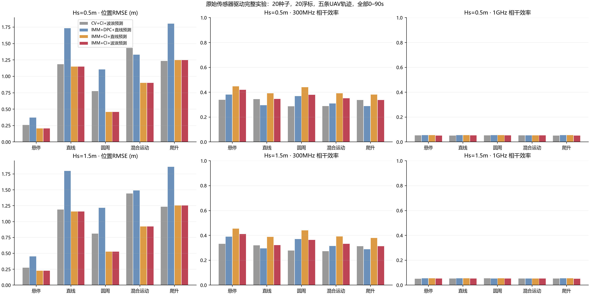
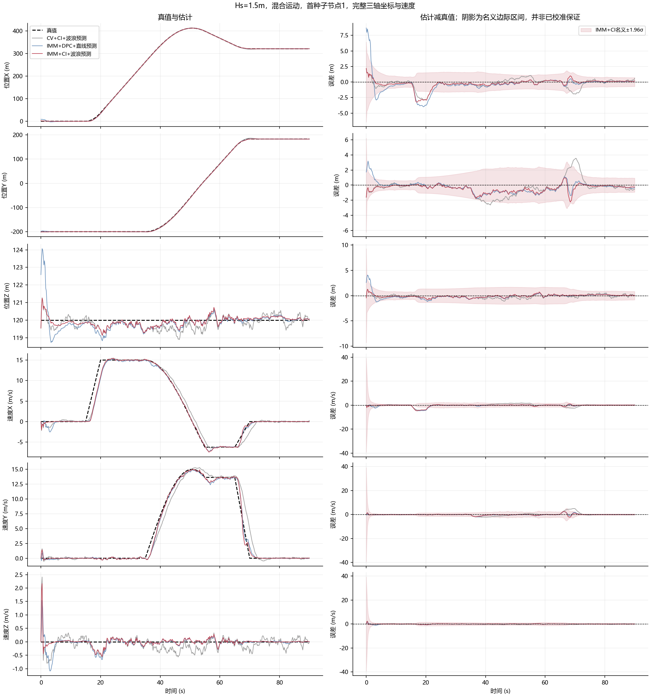
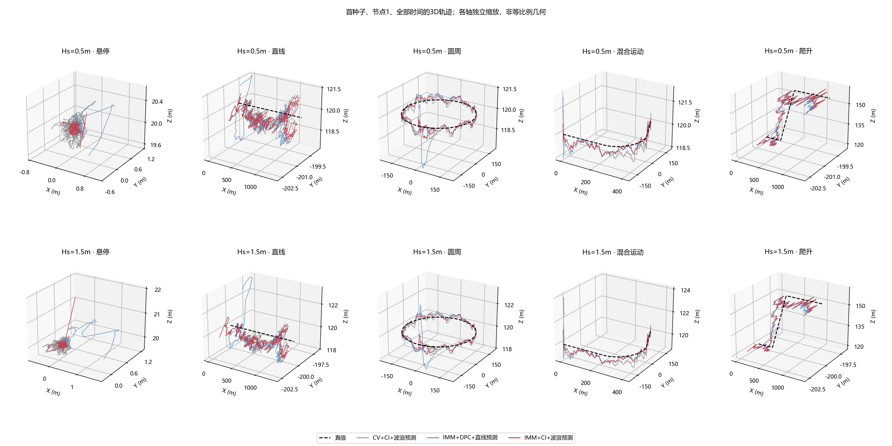
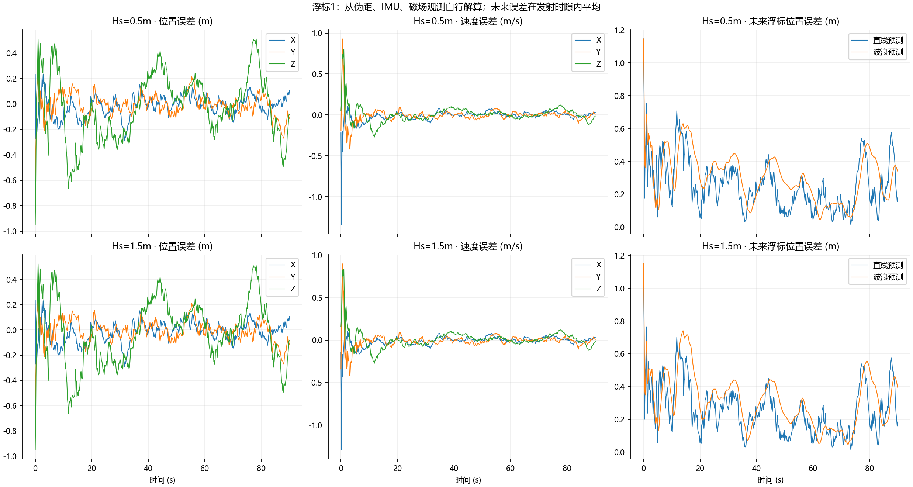
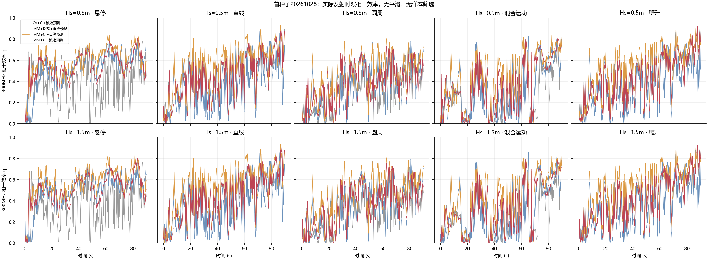

# 原始传感器驱动海上浮标—UAV完整实验

## Material Passport
- 阶段：完整仿真实现及已运行结果。
- 20种子×2海况×5轨迹×4方法×2载频；12800行种子级分段记录。
- 全时段0–90s为主结果；不设置门控、不剔除启动与机动、不平滑曲线。
- 每个浮标为一个零杆臂、共位的各向同性等效发射阵元；固定全网总功率1W。
- 算法读取8颗卫星伪距、50Hz加速度/角速度、5Hz磁场及雷达r/方位/俯仰。无真值初始化，无真实慢快分量输入。
- 导航为16维误差状态滤波；雷达直接采用原始球坐标更新；预测到137–177ms后的实际发射时隙。

## 浮标自身导航及未来位置预测

|Hs m|位置RMSE m|速度RMSE m/s|姿态RMSE °|直线未来RMSE m|波浪未来RMSE m|六维95%名义区域覆盖率|
|---|---:|---:|---:|---:|---:|---:|
|0.5|0.2226|0.1298|0.837|0.2346|0.2636|0.952|
|1.5|0.2228|0.1358|0.995|0.2352|0.2742|0.952|

覆盖率仅用于描述不确定度，不作样本门控或独立同分布显著性检验。

## UAV全时段跟踪与实际相干效率

|Hs m|轨迹|方法|位置RMSE m|速度RMSE m/s|未来位置RMSE m|η 300MHz|η 1GHz|G 300MHz dB|位置95%名义区域覆盖率|
|---|---|---|---:|---:|---:|---:|---:|---:|---:|---:|
|0.5|悬停|CV+CI+波浪预测|0.2587|0.2410|0.2778|0.3389|0.0524|8.101|1.000|
|0.5|悬停|IMM+DPC+直线预测|0.3711|0.1432|0.3796|0.3805|0.0547|8.161|1.000|
|0.5|悬停|IMM+CI+直线预测|0.2055|0.1593|0.2118|0.4478|0.0550|9.129|1.000|
|0.5|悬停|IMM+CI+波浪预测|0.2055|0.1593|0.2118|0.4203|0.0519|8.872|1.000|
|0.5|直线|CV+CI+波浪预测|1.1857|0.8872|1.2333|0.3438|0.0516|8.174|1.000|
|0.5|直线|IMM+DPC+直线预测|1.7325|1.7187|1.8371|0.2964|0.0549|7.481|1.000|
|0.5|直线|IMM+CI+直线预测|1.1483|1.0219|1.2064|0.3911|0.0554|8.737|1.000|
|0.5|直线|IMM+CI+波浪预测|1.1483|1.0219|1.2064|0.3462|0.0525|8.202|1.000|
|0.5|圆周|CV+CI+波浪预测|0.7745|1.4733|0.9696|0.2874|0.0539|7.286|0.999|
|0.5|圆周|IMM+DPC+直线预测|1.1052|1.8060|1.2784|0.3684|0.0543|8.339|1.000|
|0.5|圆周|IMM+CI+直线预测|0.4561|1.0542|0.5491|0.4404|0.0554|9.158|1.000|
|0.5|圆周|IMM+CI+波浪预测|0.4561|1.0542|0.5491|0.3796|0.0534|8.509|1.000|
|0.5|混合运动|CV+CI+波浪预测|1.4339|1.7882|1.6969|0.2896|0.0530|7.396|0.927|
|0.5|混合运动|IMM+DPC+直线预测|1.3296|1.2053|1.4698|0.3103|0.0539|7.666|0.947|
|0.5|混合运动|IMM+CI+直线预测|0.9010|1.1458|1.0561|0.3925|0.0534|8.720|0.949|
|0.5|混合运动|IMM+CI+波浪预测|0.9010|1.1458|1.0561|0.3521|0.0527|8.238|0.949|
|0.5|爬升|CV+CI+波浪预测|1.2326|0.9376|1.2893|0.3381|0.0516|8.100|1.000|
|0.5|爬升|IMM+DPC+直线预测|1.8036|1.7565|1.9167|0.2891|0.0547|7.369|1.000|
|0.5|爬升|IMM+CI+直线预测|1.2486|1.0866|1.3212|0.3819|0.0546|8.632|1.000|
|0.5|爬升|IMM+CI+波浪预测|1.2486|1.0866|1.3212|0.3374|0.0523|8.087|1.000|
|1.5|悬停|CV+CI+波浪预测|0.2742|0.2797|0.2936|0.3320|0.0519|8.030|1.000|
|1.5|悬停|IMM+DPC+直线预测|0.4516|0.1590|0.4574|0.3890|0.0547|8.336|1.000|
|1.5|悬停|IMM+CI+直线预测|0.2257|0.2013|0.2322|0.4542|0.0551|9.227|1.000|
|1.5|悬停|IMM+CI+波浪预测|0.2257|0.2013|0.2322|0.4110|0.0527|8.811|1.000|
|1.5|直线|CV+CI+波浪预测|1.1890|0.9145|1.2355|0.3193|0.0531|7.851|0.998|
|1.5|直线|IMM+DPC+直线预测|1.7964|1.7026|1.8749|0.2964|0.0548|7.483|1.000|
|1.5|直线|IMM+CI+直线预测|1.1578|1.0709|1.2175|0.3884|0.0551|8.708|0.998|
|1.5|直线|IMM+CI+波浪预测|1.1578|1.0709|1.2175|0.3215|0.0524|7.880|0.998|
|1.5|圆周|CV+CI+波浪预测|0.8095|1.4838|0.9985|0.2773|0.0544|7.134|0.996|
|1.5|圆周|IMM+DPC+直线预测|1.2174|1.7826|1.3337|0.3712|0.0539|8.377|1.000|
|1.5|圆周|IMM+CI+直线预测|0.5256|1.1065|0.6199|0.4396|0.0554|9.149|0.997|
|1.5|圆周|IMM+CI+波浪预测|0.5256|1.1065|0.6199|0.3641|0.0536|8.328|0.997|
|1.5|混合运动|CV+CI+波浪预测|1.4430|1.7971|1.7028|0.2734|0.0532|7.148|0.926|
|1.5|混合运动|IMM+DPC+直线预测|1.4903|1.2151|1.6157|0.3150|0.0536|7.734|0.948|
|1.5|混合运动|IMM+CI+直线预测|0.9244|1.1541|1.0749|0.3923|0.0537|8.719|0.947|
|1.5|混合运动|IMM+CI+波浪预测|0.9244|1.1541|1.0749|0.3326|0.0533|7.991|0.947|
|1.5|爬升|CV+CI+波浪预测|1.2345|0.9636|1.2899|0.3134|0.0530|7.769|0.998|
|1.5|爬升|IMM+DPC+直线预测|1.8636|1.7406|1.9518|0.2890|0.0547|7.369|1.000|
|1.5|爬升|IMM+CI+直线预测|1.2550|1.1328|1.3288|0.3792|0.0542|8.603|0.998|
|1.5|爬升|IMM+CI+波浪预测|1.2550|1.1328|1.3288|0.3127|0.0521|7.756|0.998|

## 混合运动：波浪预测相对直线预测的配对变化

|Hs m|阶段|Δη 300MHz|95%种子配对区间半宽|
|---|---|---:|---:|
|0.5|all|-0.04046|0.00567|
|0.5|acceleration|-0.00265|0.01059|
|0.5|braking|-0.01615|0.00880|
|0.5|turn_entry|-0.05134|0.02130|
|1.5|all|-0.05978|0.00531|
|1.5|acceleration|-0.01167|0.01187|
|1.5|braking|-0.01758|0.00757|
|1.5|turn_entry|-0.05170|0.01886|

区间是固定场景下20个独立种子差值的Student-t区间，未做多重比较校正；不能推广为任意海况和航迹的保证。RMSE列为种子级RMSE的算术平均。G=P_rx/Σa_i²，为相同总功率及真实距离下相对非相干功率和的增益；dB列为每种子增益dB的平均。非相干参考由保存的种子/物理模型重建，不重跑估计算法，不改原始per_seed.csv。

## 实现和解释边界
- Hierarchical navigation/radar fusion, not full joint MAP; temporal pose/target correlation approximated
- Secondary wave filter reuses correlated navigation outputs; its covariance is not used as calibrated joint confidence
- Finite spectral surrogate RAO, not measured hydrodynamics
- GNSS corrected code 0.3m noise with drifting receiver clock; no carrier ambiguity/multipath/ionosphere model
- Ideal RF clock/carrier synchronization; co-located sensor and single isotropic TX per buoy
- Identical assumed processing and network delay, not real-time hardware timing
- 补齐的是可运行的传感器驱动链路，不宣称已完成全局最优轨迹或最大期望相干功率的求解。
- 波浪预测相对直线预测可能无收益或退化；导航误差、短预测时间和模型失配均可能主导。具体因果需独立分析，不能只凭曲线归因。
- 新实验为20个共位单阵元浮标；旧实验80阵元，且导航假设不同，禁止将旧/新功率数值当作单变量算法比较。

## 公式、文献与复现
详见本目录 THEORY.md、README.md；原始数据、每种子指标、配对区间和源文件哈希在outputs。

